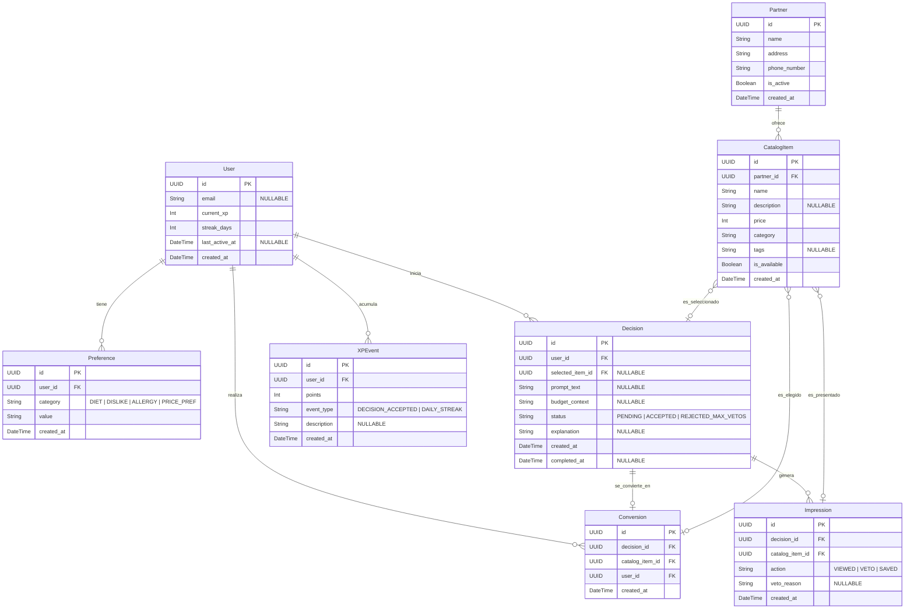

# Modelo ER y Diccionario de Datos — NOSE (MVP Fase 1)

Este documento especifica el modelo relacional y el diccionario de datos para el MVP de **NOSE Qué Comer**.

---

## 1. Diagrama Entidad-Relación (Estructura Relacional)

[User] 1 —— N [Preference]
  |
  ├─── 1 —— N [Decision] ──── N ── 1 [CatalogItem] ──── N ── 1 [Partner]
  |               |
  |               ├─── 1 ── N [Impression] ──── N ── 1 [CatalogItem]
  |               |
  |               └─── 1 ── 1 [Conversion] ──── N ── 1 [CatalogItem]
  |
  └─── 1 —— N [XPEvent]

## 2. Diccionario de Datos

### 2.1. Entidad: 'User'

.________________________________________________________________________________________________________________.
|    Atributo    | Tipo_Dato | Requerido |         Ejemplo        |         Regla_Validación / Descripción       |
|   ----------   |   ------  |   ------  |        --------        |             -----------------------          |
|       id       |   UUID    |     Si    | usr_9b1deb4d-3b7d-4bad |              Clave primeria (PK)             |
|      email     |  String   |     No    |    usuario@gmail.com   |   Único si existe. Formato válido de e-mail  |
|   current_xp   |    Int    |     Si    |           150          |      Valor por defecto '0'. Debe ser >=0     |
|   streak_days  |    Int    |     Si    |            3           | Días consecutivos de la app. Por defecto '0' |
| last_active_at |  DateTime |     No    |  2026-10-11T14:00:00Z  |             Formato ISO 8601 UTC             |
|   created_at   |  DateTime |     Si    |  2026-10-10T10:00:00Z  |             Timestamp de creación            |

### 2.2. Entidad: 'Preference'

.__________________________________________________________________________________________________________________________________.
|    Atributo    | Tipo_Dato | Requerido |         Ejemplo        |                  Regla_Validación / Descripción                |
|   ----------   |   ------  |   ------  |        --------        |                      -----------------------                   |
|       id       |    UUID   |     Si    |     pref_1234-5678     |                       Clave primeria (PK)                      |
|     user_id    |    UUID   |     Si    | usr_9b1deb4d-3b7d-4bad |                        Clave foranea (FK)                      |
|    category    |   String  |     Si    |           DIET         | Valores permitidos: 'DIET', 'DISLIKE', 'ALLERGY', 'PRICE_PREF' |
|      value     |   String  |     Si    |        VEGETARIAN      |             Texto en formato UPPERCASE o Snake_case            |
|   created_at   |  DateTime |     Si    |  2026-10-10T10:05:00Z  |                      Timestamp de creación                     |

### 2.3. Entidad: 'Partner'

.__________________________________________________________________________________________________________________________________.
|    Atributo    | Tipo_Dato | Requerido |         Ejemplo        |                  Regla_Validación / Descripción                |
|   ----------   |   ------  |   ------  |        --------        |                      -----------------------                   |
|       id       |    UUID   |     Si    |   prt_1234-5678-abcd   |                       Clave primeria (PK)                      |
|       name     |   String  |     Si    |      El Buen Sazón     |              Nombre comercial del restaurante aliado           |
|     address    |   String  |     Si    | Calle 2 # 3-45, Centro |              Dirección física para ubicar el local             |
|  phone_number  |   String  |     Si    |     +573001234567      |                    Número de contacto directo                  |
|    is_active   |  Boolean  |     Si    |           true         |       Estado del aliado (true = activo, false = inactivo)      |
|   created_at   |  DateTime |     Si    |  2026-10-10T08:00:00Z  |                      Timestamp de creación                     |

### 2.4. Entidad: 'CatalogItem'

.___________________________________________________________________________________________________________________________________________.
|  Atributo  |Tipo_Dato|Requerido|                     Ejemplo                    |              Regla_Validación / Descripción             |
|------------|---------|---------|------------------------------------------------|---------------------------------------------------------|
|     id     |   UUID  |    Si   |               itm_1234-5678-abcd               |                    Clave primeria (PK)                  |
|  partner_id|   UUID  |    Si   |               prt_1234-5678-abcd               |                     Clave foránea (FK)                  |
|    name    |  String |    Si   |             Hamburguesa Doble Carne            |          Nombre del producto o plato de comida          |
|description |  String |    No   |150g de carne 100% res, queso cheddar y tocineta|     Descripción detallada del plato o ingredientes      |
|    price   |   Int   |    Si   |                     10000                      |Precio en moneda local. Debe ser un entero positivo (> 0)|
|  category  |  String |    Si   |                   FAST_FOOD                    |     Tipo de comida en formato UPPERCASE o snake_case    |
|    tags    |  String |    No   |               CHEESE,BACON,BEEF                | Etiquetas de ingredientes o características para filtros|
|is_available| Boolean |    Si   |                      true                      |Disponibilidad_plato (true = disponible, false = agotado)|
| created_at | DateTime|    Si   |              2026-10-10T08:30:00Z              |                  Timestamp de creación                  |

### 2.5. Entidad: 'Decision'

| Atributo | Tipo_Dato | Requerido | Ejemplo | Regla_Validación / Descripción |
| :--- | :--- | :---: | :--- | :--- |
| id | UUID | Si | dec_1234-5678-abcd | Clave primaria (PK) |
| user_id | UUID | Si | usr_9b1deb4d-3b7d-4bad | Clave foránea (FK) |
| selected_item_id | UUID | No | itm_1234-5678-abcd | Clave foránea (FK) |
| prompt_text | String | No | Algo rápido para almorzar | Texto libre o prompt ingresado por el usuario |
| budget_context | String | No | 20000 | Presupuesto máximo o rango monetario en COP |
| status | String | Si | ACCEPTED | Valores permitidos: 'PENDING', 'ACCEPTED', 'REJECTED_MAX_VETOS' |
| explanation | String | No | Se ajusta a tu presupuesto y es tu categoría favorita | Explicación generada por el motor de recomendación |
| created_at | DateTime | Si | 2026-10-10T12:00:00Z | Timestamp de inicio de la decisión |
| completed_at | DateTime | No | 2026-10-10T12:03:15Z | Timestamp de finalización (nulo mientras status sea 'PENDING') |

### 2.6. Entidad: 'XPEvent'

| Atributo | Tipo_Dato | Requerido | Ejemplo | Regla_Validación / Descripción |
| :--- | :--- | :---: | :--- | :--- |
| id | UUID | Si | xpe_1234-5678-abcd | Clave primaria (PK) |
| user_id | UUID | Si | usr_9b1deb4d-3b7d-4bad | Clave foránea (FK) |
| points | Int | Si | 50 | Cantidad de puntos otorgados. Debe ser un entero positivo (> 0) |
| event_type | String | Si | DAILY_STREAK | Tipo de evento de gamificación en formato UPPERCASE |
| description | String | No | Racha diaria de 3 días consecutivos | Descripción o motivo legible para el historial del usuario |
| created_at | DateTime | Si | 2026-10-10T12:05:00Z | Timestamp de creación del evento de XP |

### 2.7. Entidad: 'Impression'

| Atributo | Tipo_Dato | Requerido | Ejemplo | Regla_Validación / Descripción |
| :--- | :--- | :---: | :--- | :--- |
| id | UUID | Si | imp_1234-5678-abcd | Clave primaria (PK) |
| decision_id | UUID | Si | dec_9b1deb4d-3b7d-4bad | Clave foránea (FK) |
| catalog_item_id | UUID | Si | itm_9b1deb4d-3b7d-4bad | Clave foránea (FK) |
| action | String | Si | VETO | Acción realizada por el usuario: 'VIEWED', 'VETO', 'SAVED' |
| veto_reason | String | No | TOO_EXPENSIVE | Motivo del veto si action='VETO' (ej. 'TOO_EXPENSIVE', 'DISLIKED_INGREDIENT') |
| created_at | DateTime | Si | 2026-10-10T12:01:30Z | Timestamp exacto en que se generó la impresión o veto |

### 2.8. Entidad: 'Conversion'

.____________________________________________________________________________________________________________________.
|     Atributo    | Tipo_Dato | Requerido |         Ejemplo         |         Regla_Validación / Descripción         |
|-----------------|-----------|   ------  |-------------------------|------------------------------------------------|
|       id        |    UUID   |     Si    |   cnv_1234-5678-abcd    |               Clave primeria (PK)              |
|   decision_id   |    UUID   |     Si    |  dec_9b1deb4d-3b7d-4bad |               Clave foránea (FK)               |
| catalog_item_id |    UUID   |     Si    |  itm_9b1deb4d-3b7d-4bad |               Clave foránea (FK)               |
|     user_id     |    UUID   |     Si    |  usr_9b1deb4d-3b7d-4bad |               Clave foránea (FK)               |
|    created_at   |  DateTime |     Si    |  2026-10-10T12:03:15Z   | Timestamp exacto de la conversión o aceptación |

## Trazabilidad de Entidades con Historias de Usuario (US)

| Entidad | Historias de Usuario Asociadas (US) | Descripción de la Relación / Necesidad Funcional |
| :--- | :--- | :--- |
| User | US-01, US-13, US-19 | Registro inicial de usuario, acumulación de XP/racha diaria y gestión de privacidad. |
| Preference | US-02, US-03, US-09 | Captura de contexto inicial, restricciones alimentarias, alergias y preferencias de presupuesto. |
| Partner | US-16 | Gestión de información básica de comercios/restaurantes aliados. |
| CatalogItem | US-04, US-16 | Base de platos y productos disponibles que alimentan las opciones de recomendación. |
| Decision | US-02, US-03, US-05, US-10, US-17 | Sesión de decisión activa, entrada de contexto, explicación del motor y estrategia de fallback. |
| XPEvent | US-11, US-13 | Registro de eventos de gamificación (acumulación de puntos XP por decisión y racha diaria). |
| Impression | US-05, US-07, US-08, US-18 | Tarjetas mostradas en pantalla, registro de vetos/descartes, aprendizaje del motor y analítica. |
| Conversion | US-06, US-11, US-18 | Aceptación definitiva del plato seleccionado, métricas de conversión y tiempo de decisión. |